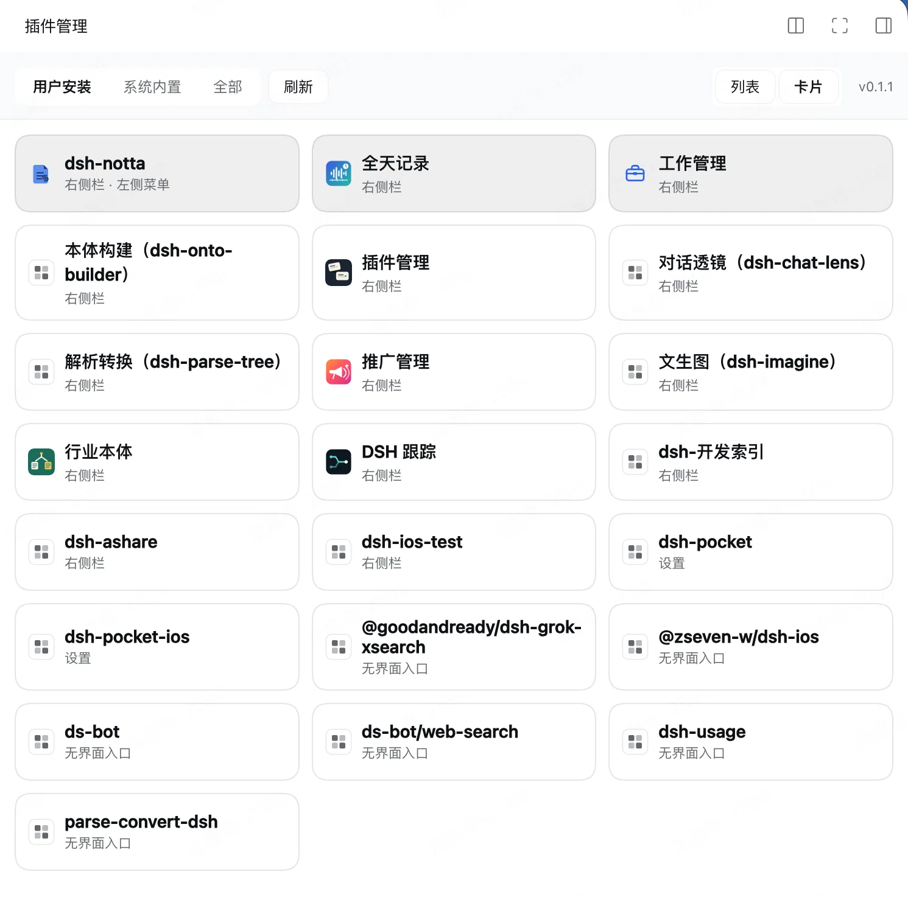

# 插件管理 · dsh-plugin-panel

给 DeepSeek Harness 右侧栏用的插件管理器。装上以后右侧栏会多一个「插件管理」标签，把已安装的插件列出来，并且告诉你每个插件到底从哪里进。



## 它解决什么

插件一多，问题不是「有没有装」，而是「装了我怎么打开」。有的插件在右侧栏，有的藏在设置页，有的只是加了一个工具、根本没有界面。翻半天找不到入口，是常态。

这个面板把两件事放到一起：

- 你装了哪些插件
- 每个插件从哪进

## 功能

- **按来源筛选**：用户安装 / 系统内置 / 全部。
- **标出入口位置**：右侧栏、设置、左侧菜单、无界面入口。列表按这个顺序排，有界面的在前，没有界面的沉底。
- **置顶**：常用插件钉在最前，背景加一层灰做区分。
- **两种视图**：列表（一行一个）和卡片（一行三列）。卡片模式下，打开、取消置顶这些按钮鼠标移上去才出现。
- **详情**：介绍、模块、入口、运行状态、包名、版本、来源、说明文档。
- **一键打开**：有右侧栏页面的插件，直接切到它的页面。
- **打开所在位置**：在访达里定位到这个插件的实际目录。
- **启停**：不必回设置页，详情里直接停用或启用。

## 安装

```bash
dsh plugin --profile desktop add dsh-plugin-panel
```

装完打开右侧栏，应该能看到「插件管理」标签。没出现就去设置 → 插件确认它已启用。

## 使用

1. 右侧栏点「插件管理」。
2. 上面一排筛选：用户安装 / 系统内置 / 全部。
3. 每个插件名字下面标着入口：`右侧栏`、`设置`、`左侧菜单`，或者 `无界面入口`。
4. 点卡片看详情；点「打开」跳到那个插件的页面；点「打开所在位置」在访达里打开它的目录。

## 说明文档从哪来

优先读插件自己声明的 `meta.detail`，没有就读它的 `README.md`。两样都没有，才会显示「没有说明文档」。

## 边界

- 只读扫描本机 profile 里的插件，不修改任何插件代码。
- 不记录插件调用历史，所以面板里没有「被调用多少次」这类数据。
- 纯界面插件不会出现在工具列表里，这是正常的。
- 置顶和视图选择存在浏览器本地，换机器不跟随。

## 开发

```bash
git clone https://github.com/jqlong17/dsh-plugins-ui.git
cd dsh-plugins-ui
node --check client.js
```

插件由 Host 半（`index.js`）和浏览器半（`client.js`）组成，入口在 `cordis.patch.yml`。

## License

MIT
