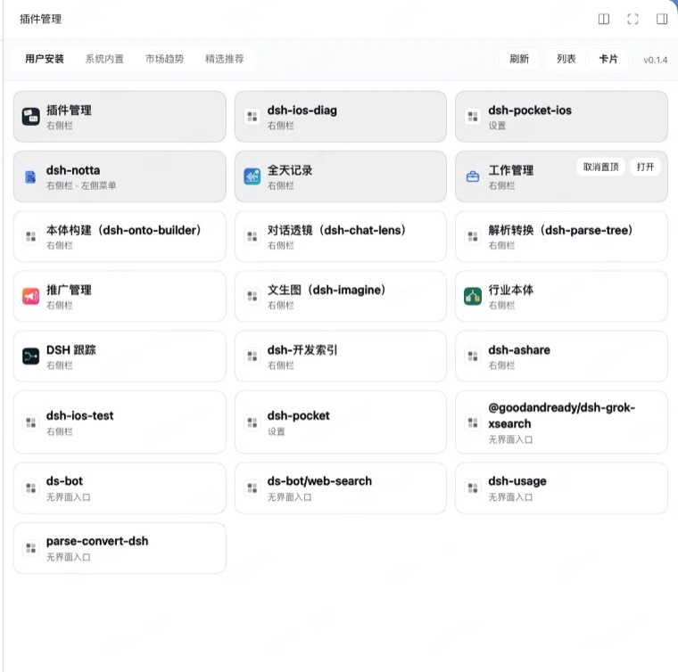
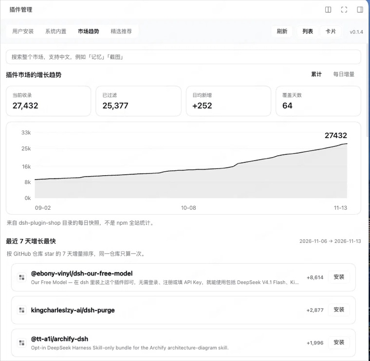
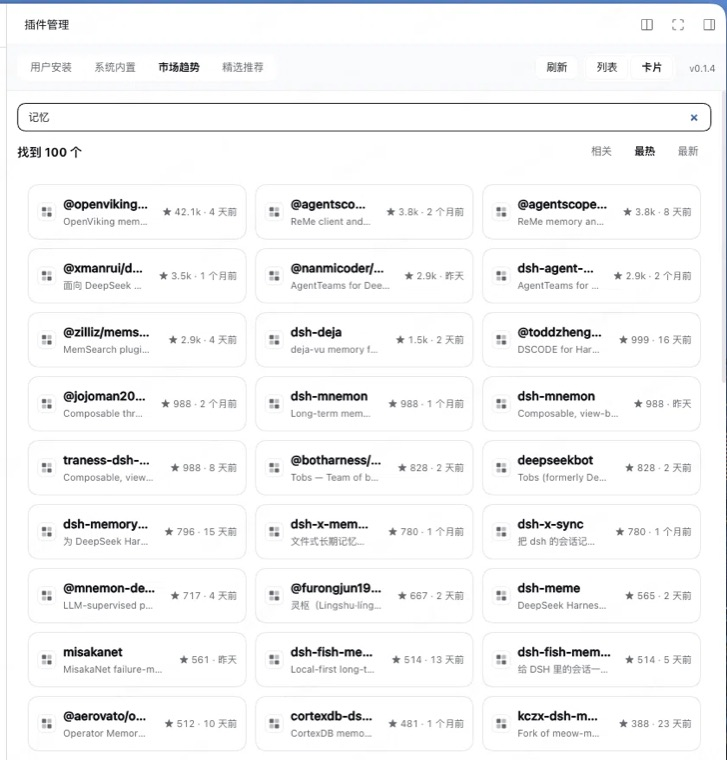

# 插件管理 · dsh-plugin-panel

装在 DeepSeek Harness 右侧栏的插件管理器：看清自己装了哪些插件、每个从哪进，也能直接浏览插件市场。



## 已装插件

- **按入口排序**：右侧栏、设置、左侧菜单、无界面入口。有界面的排在前面，没界面的沉底。
- **置顶**：常用插件钉在最前，背景加一层灰做区分。
- **列表 / 卡片**：一行一个，或一行三个，随窗口宽度切换。
- **详情**：介绍、模块、入口、运行状态、包名、版本、来源、说明文档。
- **一键打开**：有右侧栏页面的插件，直接切过去。
- **打开所在位置**：在访达里定位到这个插件的实际目录。
- **启停**：不必回设置页，详情里直接停用或启用。

## 插件市场

目录来自 `dsh-plugin-shop`，每天一份快照。



- **增长趋势**：目录收录量的变化，可切累计曲线或每日增量柱状图。
- **最近 7 天增长最快**：按 GitHub 仓库 star 的 7 天增量排，同一仓库只算一次。
- **全库搜索**：覆盖两万七千多个插件，支持中文——搜「记忆」「截图」「桌面」都能命中。
- **排序**：结果可按相关、最热、最新排，卡片上直接标出 star 数和发布距今天数。
- **一键安装 / 卸载**：搜索结果和市场榜单里点一下即可，卸载需要二次确认。
- **标签**：市场插件详情里会列出该插件命中的中文标签。



## 安装

```bash
dsh plugin --profile desktop add dsh-plugin-panel
```

也可以用 npm：

```bash
npm install dsh-plugin-panel
```

装完打开右侧栏，会多一个「插件管理」标签。没出现就去设置 → 插件里确认它已启用。

## 说明文档从哪来

优先读插件自己声明的 `meta.detail`，没有就读它的 `README.md`。两样都没有，才会显示「没有说明文档」。

## 边界

- 只读扫描本机 profile 里的插件，不修改任何插件代码。
- 不记录插件调用历史，所以面板里没有「被调用多少次」这类数据。
- 市场数据来自第三方目录的每日快照，不是 npm 全站统计；刚发布的插件要等目录下一次构建才会出现。
- 置顶、视图选择和当日市场缓存存在浏览器本地，换机器不跟随。

## License

MIT
